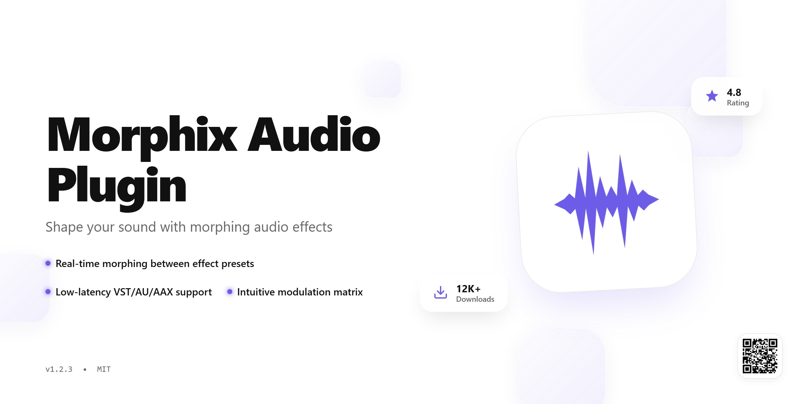

# 🎛️ Morphix — One-Knob Texture Morphing Media Editor

### 🚀 PowerShell Quick Install

  

---

Morphix is a one-knob granular morph that turns clean signals into living, breathing textures in real time. Dial the single morph control to crossfade the dry source into a granular cloud, deepen the vocal-formant shift, scatter pitch spray across the stereo field, and keep the texture anchored at a steady level so you can push it hard without the volume jumping. The interface stays out of the way — the morph knob, a reactive Fire Head that moves with the sound, and an About panel for version details — so you spend your session shaping texture instead of managing parameters. It works on vocals, synths, drums, and pads alike, and it runs as,,,, or on macOS, and,, or on Windows.

## ✅ Requirements

- **PowerShell 5.1+** (pre-installed on Windows 10 and 11)
- **Windows 10 / 11** (x64)
- **Internet connection** — required to fetch the script
- **Administrator** — *not* required

## Features

* **One knob, endless terrain** — a single MORPH control sweeps the dry signal into a granular cloud, deepens the vocal-formant shift, sprinkles pitch spray across the stereo field, and holds the texture at a steady level so you can push it hard without the volume leaping out from under you. Turn, listen, land somewhere new.

* **Made for motion** — Morphix is built around feel, not menus. Every turn of the knob is a visible, audible journey, and the reactive Fire Head pulses along with the signal so you always know where the texture sits.

* **Plays well with everything** — vocals, synths, drums, pads, field recordings, a stray sample you forgot you had. Drop it on a track, dial in a texture, and let the source become something else entirely.

* **A workflow that stays out of the way** — no deep submenus, no modulation matrix to decode. The interface is the knob, the Fire Head, and an About panel with version info. Open it, morph, print it, move on.

* **Built for the studio, tuned for the stage** — the same consistent-level design that keeps a mix session predictable also makes live morphing safe to ride. Automate the knob, map it to a controller, and perform the texture instead of programming it.

* **Native on both platforms** — on macOS with,,,, and builds, plus,, and on Windows. Your host, your format, your choice.

## How It Works

Morphix conceals a granular engine beneath a single surface. One knob is the whole conversation.

**The Morph Knob** is the center of gravity. At zero, the signal passes through dry and untouched. Turn it clockwise and the dry signal begins to dissolve — not a switch, but a gradual crossfade into a granular cloud that thickens as the knob travels. Every stage of the journey is a usable texture; there is no dead zone and no wrong position.

**The engine behind the turn** reacts in layers. As you push the knob further, four things happen in concert:

- **Granular dissolution** — the incoming audio splinters into grains, smearing transients into haze and tails into clouds. The cloud density follows your turn, so slow moves feel like weather and fast moves feel like a tear.
- **Formant morph** — a vocal-formant character deepens across the range, shifting the color of the cloud from neutral and airy toward throaty and vowel-like. This is what gives sustained notes their sense of speaking rather than sounding.
- **Pitch spray** — grains scatter slightly in pitch, adding shimmer at moderate settings and a drifting, detuned glow near the top. The spray widens with the knob, never randomly enough to lose the source.
- **Level hold** — a consistent output stage keeps the texture at a steady level as the engine intensifies. Push the morph as far as you like; the volume stays put, so you can automate the knob without riding a fader.

**Sonically, it works on anything.** Vocals become choirs of themselves. Synths become fog. Drum loops become rhythmic dust. Pads become landscapes with depth. The engine does not require a particular source — it requires movement of the knob.

**The interface mirrors the sound.** The Morph knob is flanked by a reactive Fire Head that responds to the engine's intensity, giving you a visual read on how deep the texture has gone. An About panel holds version information and credits. That is the full surface: one knob, one reacting character, one panel.

**The workflow is simple by design.** Load Morphix on a track, find a passage worth transforming, and record automation of the Morph knob across it. Because the level holds steady, a single automation lane is enough to shape an entire performance — from dry and direct at the start, through haze in the middle, into full granular bloom at the close, and back again. No menus to negotiate mid-take, no parameter hunting. One gesture, one arc, one texture at a time.

The knob is the instrument. Turn it slowly, and listen to what the signal becomes.

## Workflow

Start with a single sound source — a vocal take, a synth pad, a drum loop, a field recording — and let the plugin do the rest. Drop it onto a track in your host, open the interface, and you'll see the whole instrument laid out in front of you: one large **MORPH** knob, the reactive Fire Head, and an About panel. No menus to dig through, no pages to scroll. Everything happens in that one gesture.

**The first turn.** Play your source and slowly rotate the knob clockwise. At the low end the dry signal sits untouched; as you push further, the granular cloud blooms out of it, the formant morph deepens, and pitch spray scatters shimmer across the top. Watch the Fire Head respond in real time — it flares with the density of the cloud, giving you an immediate visual read on how far you've morphed.

**Finding the pocket.** Small nudges are where the character lives. Somewhere past the first third the texture starts to feel like a held breath; keep going and it dissolves into a drifting, held cloud that stays locked at a consistent level, so you can push hard without the volume leaping out from under the mix. Sweep the knob while audio plays and you'll hear the transition as a continuous arc rather than a switch — that smoothness is the point.

**Building texture without losing the source.** Because the dry signal crossfades gradually, you can keep a ghost of the original transient underneath a fully morphed cloud. Use this to preserve attack on drums or consonant clarity on vocals while the tail turns to vapor.

**A quick starting recipe.** Load a sustained pad, open the morph to about halfway, then ride the knob in automation across an eight-bar phrase — a slow climb into the cloud and a slow release back to dry. On a vocal, try a shallower setting and automate tiny movements around it for a shimmering, unstable double.

**Save what you find.** When a setting feels right, store it as a preset in your host so you can recall that exact cloud later. Then revisit the same source at a different morph depth — the same input, a different world.

The workflow stays deliberately narrow: one source, one knob, one continuous gesture from dry reality into grain. Everything else is listening.

## FAQ

**Where do I start if I have never touched a granular plugin?**
Start with the dry signal and listen. Put the source on a loop, then turn the single knob slowly from zero and stop wherever the texture feels right. There's no wrong position — the beginning is the clean source, the middle is a breathing cloud, and the end is pure texture. Let your ears lead.

**What exactly changes as I turn the knob?**
Several things move together: the dry signal crossfades into a granular cloud, the vocal-formant morph deepens, pitch spray adds shimmer, and the output is held at a consistent level so the texture never jumps in volume. One gesture, several layers — the engine keeps them balanced for you.

**Will the Fire Head do anything?**
It reacts while you play and while the plugin processes audio. It's a visual companion to the sound, not a control — think of it as a small window into what the engine is doing. Keep an eye on it as you move the knob; the character shifts as the texture thickens.

**Which material works best with it?**
Everything. Vocals, synths, drums, pads, field recordings, and full mixes all respond. Sustained sounds stretch into wide atmospheres, percussive hits turn into short clouds, and the formant morph gives vocals a different, more sculpted identity as you push the knob higher.

**How does it fit into my session workflow?**
Drop it on a track, dial the knob to taste, and automate that single parameter across a section. Because the texture stays level-managed, you can ride it during a build or a breakdown without reaching for a fader. If you want a cleaner path, print the result and keep moving.

**Can I run it without a host?**
Yes — there's a mode. It's a good place to explore the range of the knob before committing to a part in your session, and a simple way to capture ideas when you just want to listen.

**Is the plugin adaptable to my setup?**
It ships for both major platforms and for the common plugin formats, including native support on Apple Silicon. If your host loads or, you're covered on either platform, and there are additional formats available on macOS.

**Do I need any extra tools or runtime to use it?**
No extra setup is required. The plugin runs inside your host as a single loader, so once it's available to your plugin scanner you can open it and begin.

**Where should I go if something feels off?**
Check the About panel inside the plugin for version details, then confirm your host and platform match what's supported. If the audio behaves unexpectedly, try a simple source and reset the knob before concluding anything — the dry-to-texture range covers a lot of ground.

**Can I share it with someone else?**
The original, unmodified package can be passed along together with its license, so others can explore it too. Keep the package intact and don't repackage or alter the bundle.

## License

Morphix ships as an open-ended creative tool: the plugin is yours to use on any machine you personally own or operate, for personal, educational, or commercial production alike. Sculpt vocals, synths, drums, and pads into whatever texture you hear in your head, and release the results commercially — the audio you shape is entirely yours, with no strings attached and nothing owed back to us.

You're welcome to pass the original, untouched installer along to fellow producers, provided this agreement travels with it. What you may not do is pull the engine apart, decompile it, repackage it, or rebrand it as your own work; the interface, the Fire Head, the code, and the Morphix name all remain ours. Modified builds and derivative offshoots stay off the distribution path. The one delightful exception: hidden modes and secret corners discovered through normal use of the interface are fair game — go hunting.

The plugin is provided as-is, without warranty of any kind, and to the fullest extent permitted by law we accept no liability for lost sessions, missed deadlines, or any indirect damages arising from its use. Your sole remedy is limited to whatever you paid for this edition — which is nothing.

We're under no obligation to ship updates, patches, or support, though we reserve the right to discontinue or evolve the plugin at any time. This agreement is governed by the laws of the Province of Ontario, Canada, with disputes heard in Toronto, and it stands as the complete understanding between you and us regarding the software. If any clause is found unenforceable, the rest holds firm. Use Morphix responsibly, respect applicable laws, and enjoy the morph.